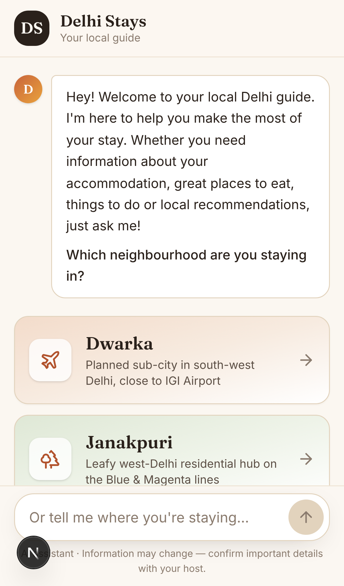
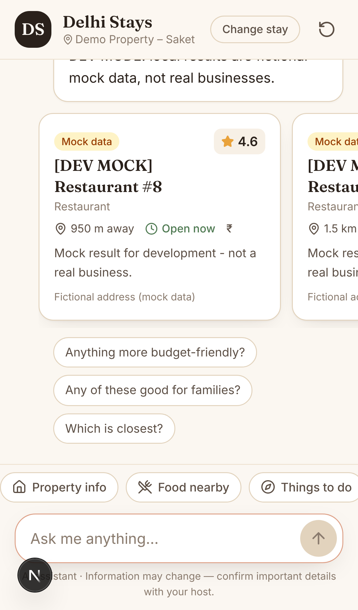
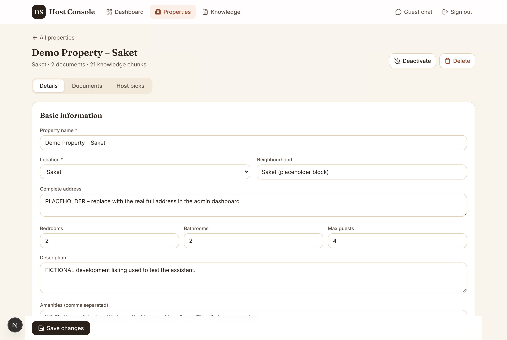

# Delhi Stays — Location-Aware Airbnb Guest Assistant

A multi-property RAG chatbot that acts as a friendly local guide for guests staying at Airbnb properties in **Dwarka, Janakpuri and Saket (Delhi)**. It answers property questions from each property's own verified knowledge base, and recommends nearby places using **live Google Places results measured from the property's exact coordinates**.

| Guest chat (mobile) | Recommendations | Admin console |
|---|---|---|
|  |  |  |

## What it does

- **Property Q&A (RAG):** PDF, DOCX, TXT, Markdown, CSV and JSON ingestion → cleaning → structure-aware chunking → embeddings → PostgreSQL/pgvector. Hybrid retrieval (vector + full-text, reciprocal-rank fusion) is **hard-filtered by `property_id`** inside SQL, and backed by a composite foreign key so a chunk can't be attached to another property's document. Answers are grounded only in retrieved text; otherwise the assistant says *"I don't have confirmed information about that yet. Let me suggest checking with your host."*
- **Local discovery:** Google Places API (New) Text/Nearby Search and Place Details, haversine distances from the exact property coordinates, configurable radius, filtering (open now, price, rating), and configurable ranking (relevance + distance + Bayesian-smoothed rating + open status + budget fit). Host-curated picks complement, rather than replace, live results.
- **Conversational intelligence:** a Claude query planner (structured output) classifies each message into the six intents, rewrites follow-ups ("something cheaper", "any of these good for families?"), extracts preferences (budget, diet, companions, travel mode, distance) and detects property switches. English and Hinglish are both handled. A deterministic heuristic planner is the fallback and an emergency safety net.
- **Safety:** emergency answers lead with India's 112 and the host's contact. Sensitive facts (Wi-Fi passwords, door codes) are isolated chunks, can be gated behind a per-property **guest PIN**, and are never available to other properties. Prompt-injection hardening treats documents and search results as data. Rate limiting, bcrypt + JWT admin auth, upload validation and log redaction are all in place.
- **Graceful degradation:** with no Claude key, or during a Claude outage, the assistant gives extractive answers; with no Google key or a Places outage it states the limitation honestly; a document that fails to process is recorded with its error; database errors return 503.

## Tech stack

Next.js 16 (App Router, TypeScript, Tailwind 4, Lucide) · FastAPI + Pydantic + async SQLAlchemy · PostgreSQL 16 + pgvector (HNSW) · Anthropic Claude (`claude-opus-5-5` by default) · OpenAI `text-embedding-3-small` (configurable) · Google Places API (New) · Alembic · pytest · Playwright · Docker Compose · Vercel / Render / Supabase.

## Quick start (local)

```bash
cp .env.example .env            # optionally add ANTHROPIC_API_KEY / OPENAI_API_KEY / GOOGLE_MAPS_API_KEY
docker compose up --build -d
docker compose exec backend python -m scripts.seed
```

Open the guest chat at http://localhost:3000, and the admin console at http://localhost:3000/admin, logging in with `admin@example.com` / `ChangeMe-Dev-2026!` (development only; set `ADMIN_EMAIL`/`ADMIN_PASSWORD` to override). The API docs are at http://localhost:8000/docs.

Without a Google key, set `PLACES_PROVIDER=mock` in `.env` to see clearly labelled **fictional** place cards in development. For a non-Docker setup, see [docs/setup.md](docs/setup.md).

## Which features need credentials

| Feature | Without keys | With keys |
|---|---|---|
| Property Q&A | ✅ Works: offline extractive answers that quote the retrieved guide | `ANTHROPIC_API_KEY`: natural, conversational Claude answers |
| Intent routing / follow-ups | ✅ Heuristic planner (English + common Hinglish) | Claude planner (structured output) with heuristic fallback |
| Embeddings | ✅ Local lexical hashing embedder (no semantic understanding) | `OPENAI_API_KEY`: `text-embedding-3-small` semantic search (re-index after switching) |
| Local recommendations | ⚠️ Honest "live search not configured" message; host picks still shown; or `PLACES_PROVIDER=mock` for fictional dev data | `GOOGLE_MAPS_API_KEY`: live Google Places results |

> **Verification status.** No API keys were available while building this project, so the **live Anthropic, OpenAI and Google Places integrations have not been exercised against the real services**. Their request construction and response handling are covered by tests that run the real Anthropic SDK and the Google client against mocked HTTP transports (`tests/unit/test_claude_client.py`, `tests/unit/test_location_units.py`). Everything else (database, RAG, isolation, orchestration, UI, Docker images) has been run end to end. Run `pytest -m live` with `LIVE_ANTHROPIC_API_KEY` set, and see [docs/setup.md](docs/setup.md#verifying-live-integrations), to verify the live integrations once you have keys.

## Project structure

```
airbnb-assistant/
├── backend/                FastAPI app
│   ├── app/
│   │   ├── api/            routes: public (guest, chat SSE, places) + admin
│   │   ├── core/           config, database, security, rate limiting, logging, errors
│   │   ├── models/         SQLAlchemy models (9 entities)
│   │   ├── schemas/        Pydantic schemas incl. structured property data model
│   │   ├── rag/            extractors, chunking, embeddings, ingestion, profile docs, retriever
│   │   ├── location/       Google Places client, categories, geo, ranking, discovery
│   │   ├── llm/            Claude client, planner (LLM + heuristic), context builder, offline composer
│   │   ├── prompts/        system_prompt.md, planner_prompt.md (configurable)
│   │   └── services/       orchestrator, sessions, properties
│   ├── migrations/         Alembic (pgvector, HNSW, GIN, constraints)
│   ├── scripts/            seed, create_admin, evaluate, make_sample_binaries
│   └── tests/              unit + integration (pytest)
├── frontend/               Next.js app (guest chat at /, admin at /admin) + Playwright e2e
├── data/
│   ├── sample_documents/   FICTIONAL development documents (md, csv, json, txt, docx, pdf)
│   └── eval/               evaluation set + latest results
├── docs/                   architecture, setup, API, deployment, evaluation report, openapi.json
├── docker-compose.yml · render.yaml · .env.example · .github/workflows/ci.yml
```

## Testing

```bash
cd backend && pytest -q                           # 179 unit + integration tests (needs PostgreSQL+pgvector)
cd frontend && npm run lint && npm run typecheck
cd frontend && npx playwright test                # E2E against the running stack (see docs/setup.md)
cd backend && python -m scripts.evaluate --places mock   # writes docs/evaluation_report.md
```

Latest results: [docs/evaluation_report.md](docs/evaluation_report.md).

## Documentation

- [Architecture](docs/architecture.md): components, data model, request flow, isolation and security design
- [Setup](docs/setup.md): local development, API keys, migrations, seeding, documents and embeddings
- [API](docs/api_documentation.md): endpoints, the SSE chat protocol and examples (plus `docs/openapi.json`)
- [Deployment](docs/deployment.md): Supabase, Render/Railway, Vercel and production checklist

## Sample data

The three seeded properties (`Demo Property – Dwarka/Janakpuri/Saket`) and every document in `data/sample_documents/` are **fictional development data**. Placeholder coordinates are rough locality centre-points for testing only. Replace them with real details through the admin console. The Janakpuri demo property has the development guest PIN `2468`.
